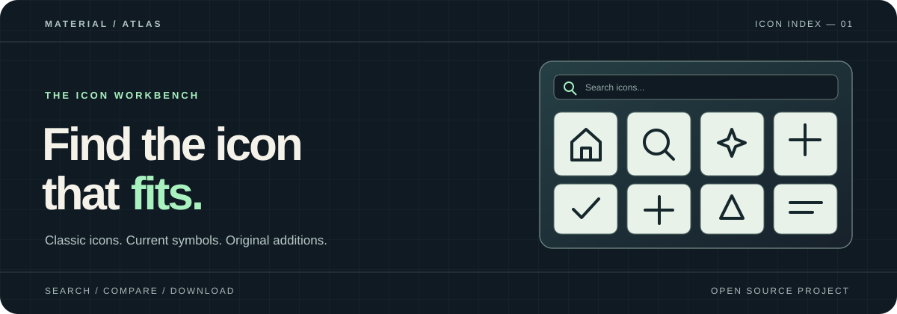

<p align="center">
  
</p>

<h1 align="center">Material Atlas</h1>

<p align="center">Find an icon, compare styles, and download the file you need.</p>

<p align="center">
  <a href="https://geevarghesekthomas84-sys.github.io/material-atlas/">Open the icon explorer</a> ·
  <a href="#quick-start">Quick start</a> ·
  <a href="#collections">Collections</a> ·
  <a href="#use-an-icon">Use an icon</a> ·
  <a href="#updating-the-library">Update the library</a>
</p>

---

Material Atlas is a static icon explorer built around Google's classic Material Icons archive, a selected set of newer Material Symbols, and 18 independent additions. Search by name, filter by collection, category, or style, inspect an icon, and export SVG or PNG. The classic collection also includes five local icon fonts.

> [!NOTE]
> This is an independent project. Google did not create or endorse Material Atlas. Google artwork and original additions are identified separately in the explorer.

## Quick start

Run a local server from the repository root:

```sh
python -m http.server 8000
```

Open **[localhost:8000](http://localhost:8000/)**. The page fetches its icon indexes, so opening `index.html` directly may not work.

## Collections

| Collection | Included here | Styles |
| :-- | :-- | :-- |
| **Classic Material Icons** | 6,862 SVG variants from the legacy Google archive | Filled, outlined, round, sharp, two tone where available |
| **Material Symbols** | 138 selected SVG variants from a [pinned Google revision](symbols/README.md) | Outlined, rounded, sharp |
| **Original additions** | 18 [independent SVGs](originals/README.md) | Original |

The explorer supports name search, collection and style filters, icon inspection, SVG downloads, and browser-rendered PNG downloads at **24, 48, 96, or 192 px**. Select **Icon font** to get a classic font file for its style.

## Use an icon

Classic SVGs follow `src/<category>/<icon>/<style>/<size>px.svg`. For example:

```html

```

For the included fonts, see [`font/`](font/). You can also use Google's hosted Material Icons font:

```html
<link rel="stylesheet" href="https://fonts.googleapis.com/css2?family=Material+Icons">
<span class="material-icons" aria-hidden="true">home</span>
```

## Project map

| Path | Purpose |
| :-- | :-- |
| [`index.html`](index.html), [`site.css`](site.css), [`site.js`](site.js) | Responsive explorer page |
| [`src/`](src/) and [`font/`](font/) | Classic SVGs and five local fonts |
| [`symbols/`](symbols/) | Selected current Material Symbols and sync script |
| [`originals/`](originals/) | Independent artwork and attribution |
| [`preview/`](preview/) | Gallery index generator and generated icon index |
| [`update/`](update/) | Python updater for Google assets |
| [`tests/`](tests/) and [`.github/workflows/`](.github/workflows/) | Tests and index validation |

Android, iOS, and pre-rendered PNG asset folders are distributed separately to keep this repository smaller. The gallery's PNG export works without them.

## Updating the library

Use **Python 3.9+**. The updater has no third-party Python dependencies and needs an internet connection to fetch assets.

```sh
python update/update_repo.py --help
python update/update_repo.py --dry-run --icon-limit 1
python update/update_repo.py --skip-existing
python preview/build_manifest.py
python -m unittest discover -s tests -v
```

The updater fetches SVGs and fonts by default. Narrow a run with `--category`, `--style`, `--icon-limit`, or repeated `--format` options:

```sh
python update/update_repo.py --category action --style "Material Icons Round" --format svg --refresh
```

After changing classic SVGs, regenerate and commit `preview/icons.json`. Explicitly filtered updater runs leave `update/current_versions.json` unchanged. The validation workflow checks the index and runs the tests. See the [Material Symbols sync instructions](symbols/README.md) for that separate collection.

## Attribution and collaboration

Google's original artwork is provided under the [Apache License 2.0](LICENSE). Preserve the license and copyright notices when redistributing it. See [CONTRIBUTING.md](CONTRIBUTING.md) for project maintenance and [Google collaboration notes](docs/google-collaboration.md) for the upstream icon request process.
